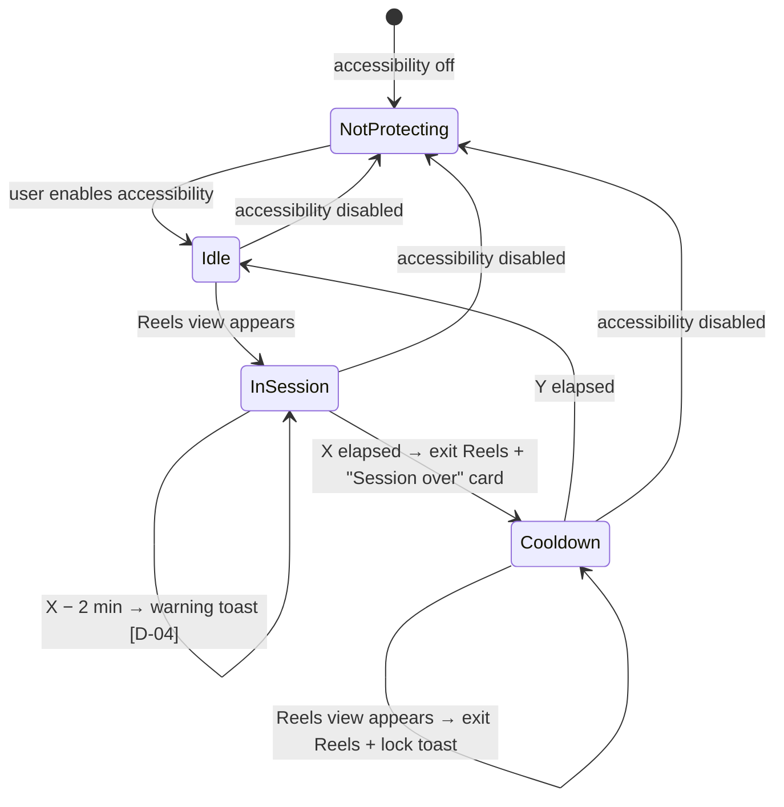

# Anti-Doom-Scroll — Interaction Design

Status: **Proposed** · Created: 2026-10-08 · Source: [requirements.md](requirements.md)
Fidelity: text specification plus a low-fidelity wireframe ([mockups/screens.html](mockups/screens.html)). The wireframe uses simulated data and contains no production code.

Decisions D-01 to D-04 were accepted by the owner on 2026-10-08:
- wall-clock session time;
- DM reels are always allowed;
- settings changes during Cooldown apply after it ends;
- a warning 2 minutes before the end.

Each spot that depends on a decision is tagged `[D-0x]`.

## 1. Context

- **Actor:** the owner, the only user, on their Android phone. Language: English. Time format follows the phone's 12h/24h setting.
- **Design system:** no existing design. Use standard Material 3 components (cards, buttons, Toast, Snackbar). No custom patterns unless noted.
- **Two surfaces:**
  1. **The app itself:** onboarding, main status screen, settings, today's log.
  2. **Inside Instagram:** brief feedback shown by the accessibility service (Toast or overlay). The app never changes Instagram's own screens.

## 2. State diagram

Text version: NotProtecting means the service is off, so nothing is enforced. Idle → InSession happens on the first Reels view. InSession → Cooldown happens when X has elapsed on the wall clock `[D-01]`. Cooldown → Idle happens when Y has elapsed. Turning accessibility off from any state goes to NotProtecting. Session and cooldown end times are kept, so if accessibility comes back before the cooldown end time, the app resumes the correct state (R-10).

## 3. Journeys

### J1. First-time setup (R-12)

| Step | Screen | Content | Action → result |
|---|---|---|---|
| 1 | **Welcome** | "Limit Reels, not Instagram." Bullets: 30-min sessions, then a 90-min break. Feed, Stories and DMs stay untouched. | **Get started** → step 2 |
| 2 | **Why accessibility** | "To spot when Reels is open, this app reads which Instagram screen is showing. It reads nothing else. Nothing leaves your phone. The app has no internet access." | **Continue** → step 3 |
| 3 | **Allow restricted settings** (Android 13+ only, shown only if needed) | Numbered steps: 1. Tap **Open app info**. 2. Tap ⋮ (top right). 3. Tap **Allow restricted settings**. 4. Come back here. | **Open app info** opens the system App info screen. Coming back re-checks; if allowed → step 4. |
| 4 | **Turn on access** | "Turn on Anti-Doom-Scroll in Accessibility → Installed apps." | **Open Accessibility settings**. On return: if enabled → step 5; if not → inline message "Access is still off. Try again." |
| 5 | **Keep it running** (recommended, skippable) | "Some phones stop background services to save battery. Exempt this app so limits keep working." (A-03) | **Open battery settings** / **Skip** → Main |

- **Exit:** back from any step returns to the previous step. Leaving setup unfinished opens the Main screen in NotProtecting.
- **Recovery:** returning from system settings always re-checks the real permission. The app never assumes a step succeeded.

### J2. Watch Reels in a session (R-01–R-04, R-07)

1. **Entry:** the user opens Reels in Instagram while Idle, from the tab, the feed or a profile. A DM reel does not start a session (J7) `[D-02]`.
2. **Session starts silently.** Reels plays normally with no overlay, which keeps watching undisturbed.
3. **At X − 2 min `[D-04]`:** a Toast shows "2 min left in this Reels session." (long duration, once).
4. **Leaving and returning** (e.g. checking DMs): the timer keeps running `[D-01]`. No feedback.
5. **At X:** the service exits Reels and shows the **Session-over card** (overlay, see §4.2) for 4 s. The state is now Cooldown.

### J3. Try Reels during Cooldown (R-05)

1. **Entry:** the user opens any Reels view.
2. Within 1 s the service exits Reels.
3. A Toast shows "Reels locked · back at 16:10 (1 h 12 m)."
4. **Repeated attempts:** each attempt exits Reels again. The Toast shows at most once per 10 s, so it doesn't flood the screen.

**Exit behavior, shared by J2 step 5 and J3:**
- The service presses Back.
- If a Reels view is still showing after 500 ms, it presses Back again, up to 3 times.
- If Reels is still showing, the service opens Instagram's home feed. If that fails, it goes to the phone's home screen.
- **Result:** the user lands on the screen they came from, or a safe screen. They are never stuck in a loop.

### J4. Check status (R-09, R-11)

- **Entry:** the user opens the app (launcher icon).
- **Main screen:** a status card (§4.1), today's total, and a link to Settings.
- **"Today: 42 min · 2 sessions"** row → tap → **Today log** listing each session: "14:02–14:32 · 30 min". Back → Main.
- **Empty log:** "No Reels today." Shown as text, not an error.
- **Countdown updates:** once per second while the screen is visible.

### J5. Change limits (R-08, R-14)

**Settings layout:**
- Two rows, **Session length** and **Cooldown**. Each has a − / value / + stepper in 5-minute steps.
- Tapping the value opens a number field for exact entry.
- **Save** is enabled only when a value has changed.

**Validation:**
- Checked when the number field loses focus, and on Save.
- Error message: "Enter a number from 1 to 180."
- The steppers stop at 1 and 180. At the limit, the button is disabled and has an accessible label.

**Idle or InSession:**
- Save applies the change right away and shows the Snackbar "Saved."
- A running session keeps its original end time; new values apply to the next session.
- Sub-text under the rows: "Applies from the next session."

**Cooldown `[D-03]`:**
- A banner at the top: "Locked until the cooldown ends at 16:10. Changes will apply then."
- Saving stores the values as pending. The rows show "Pending: 20 min".
- The current cooldown end time does not change.

**Leaving with unsaved changes:**
- Back discards them without a dialog. The changes are cheap to redo, so no confirmation is needed.

### J7. Watch a reel a friend sent (R-15) `[D-02]`

1. **Entry:** the user opens a reel inside a DM thread, in any state.
2. **The reel plays normally.** No toast and no exit. The state does not change.
3. **Swiping to the next reel** makes it a normal Reels view:
   - In Idle, it starts a session silently (J2).
   - In InSession, it continues the session.
   - In Cooldown, it is exited (J3). Back returns toward the DM thread.
4. **Exit:** Back returns to the DM thread.

### J6. Protection is lost (E-02)

- **Main screen:** the status card switches to **Not protecting** (§4.1) with **Turn on**. The button reopens J1 at step 4 (or step 3 if needed).
- **No nagging:** no notification spam. The warning only shows when the app is opened.

## 4. Screen and surface specs

### 4.1 Main status card (R-11)

| State | Icon + title (never color alone) | Big value | Sub-text | Action |
|---|---|---|---|---|
| NotProtecting | ⚠ **Not protecting** | — | "Accessibility access is off. Reels is not limited." | **Turn on** (filled button) |
| Idle | ▶ **Reels available** | — | "Opening Reels starts a 30-min session." | — |
| InSession | ⏱ **Session running** | `24:13` left | Progress bar · "Ends at 14:32" | — |
| Cooldown | 🔒 **Reels locked** | `1:12:40` | "Back at 16:10" | — |

There is deliberately **no pause or skip button**. A one-tap bypass is the failure the research flagged (ln-11). Turning the app off happens only in system settings.

### 4.2 Session-over card (inside Instagram)

- **What it is:** an accessibility overlay card at the bottom of the screen. It doesn't block touches above it.
- **Copy:** "Session over" / "Reels is back at 16:10."
- **Dismissal:** auto-dismisses after 4 s; tapping it dismisses it immediately.
- **Why an overlay instead of a Toast:** a Toast is easy to miss at the moment a 30-minute session ends.
- **Simpler fallback:** a long Toast with the same text, if the overlay turns out unreliable in testing.

### 4.3 Copy rules

- Times show both forms: the clock time ("16:10") and the remaining duration ("1 h 12 m").
- No shaming copy and no error codes. The words for the states are always: *session*, *cooldown*, *locked*.

## 5. Accessibility and device behavior

- **TalkBack names:**
  - Status card reads as one unit, e.g. "Reels locked, back at 16:10, 1 hour 12 minutes left."
  - Steppers: "Decrease session length", "Session length, 30 minutes", "Increase session length".
- **Announcements:** the countdown is **not** announced every second. Only state changes are announced (polite live region).
- **Touch targets:** at least 48 dp.
- **Text:** uses sp units. At 200% font size the countdown may wrap below the title, and the layout scrolls vertically.
- **Light and dark theme:** both follow the system. State cues use an icon plus text, never color alone.
- **Rotation:** portrait-first. Landscape uses the same single column, scrollable.
- **Focus:** after returning from system settings, focus moves to the updated status or step heading.

## 6. Requirement coverage

| Req | Where designed |
|---|---|
| R-01, R-02 | J2 entry; state diagram |
| R-03, R-04 | J2 steps 4–5; §4.2 |
| R-05 | J3; exit behavior |
| R-06 | State diagram (Cooldown → Idle); §4.1 Idle |
| R-07 | J2 step 3 `[D-04]` |
| R-08 | J5 |
| R-09 | J4 Today row and log |
| R-10 | §2 text; J6 |
| R-11 | §4.1 |
| R-12 | J1; J6 |
| R-13 | J1 step 2 copy (claim must hold: no INTERNET permission) |
| R-14 | J5 Cooldown `[D-03]` |
| R-15 | J7 `[D-02]` |
| E-01 | Not visible to the user by design: if detection fails, Reels is simply not limited. No UI. |
| E-04 | No UI (best effort). |

## 7. New behavior added beyond the requirements (approved by owner 2026-10-08)

- **N-01:** Toast throttle, at most once per 10 s (J3).
- **N-02:** Back-press retry with fallback to Instagram home (exit behavior).
- **N-03:** Session-over overlay card instead of a Toast (§4.2).
- **N-04:** Optional battery-exemption step in setup (J1 step 5).
- **N-05:** No in-app pause or skip (§4.1).
- **N-06:** Today log list screen (J4). R-09 only needs the daily total.

## 8. Untested assumptions

- **U-01:** A 4 s overlay is noticeable but not annoying. Owner check during the first days.
- **U-02:** A Toast at X − 2 min is visible over full-screen Reels video.
- **U-03:** Back from a reel opened inside the Reels tab returns to a non-Reels screen within 3 presses. Depends on the current Instagram navigation.
- **U-05:** A DM reel can be told apart from a Reels view (requirements A-04).
- **U-04:** Accessibility overlays (TYPE_ACCESSIBILITY_OVERLAY) show over Instagram on the owner's phone and Android version.

**Update 2026-10-08:** the owner ran the phone acceptance pass on the built app (X = 2, Y = 3) and reported everything working as expected, including the session-over card, exiting Reels, DM reels and untouched feed/Stories/DMs. U-01 (whether the card is annoying over time) still needs a few days of normal use.
